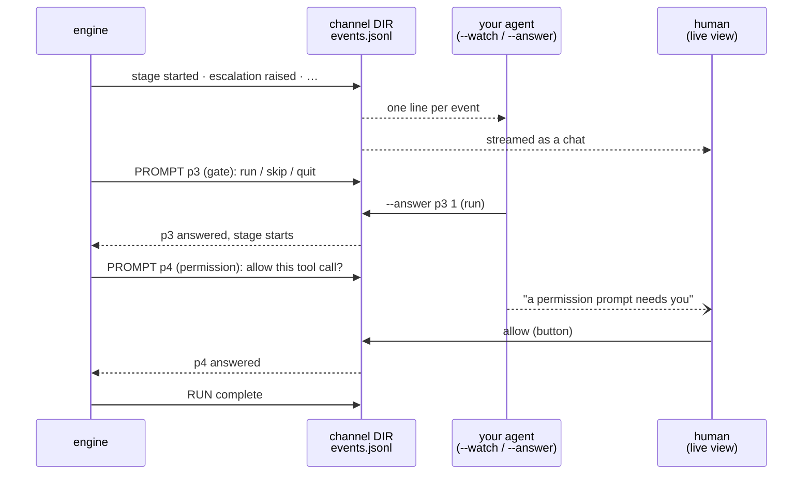
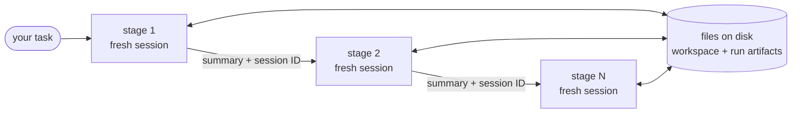
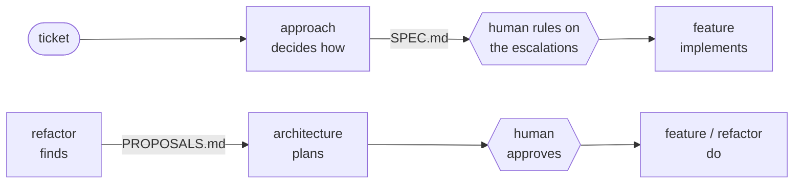
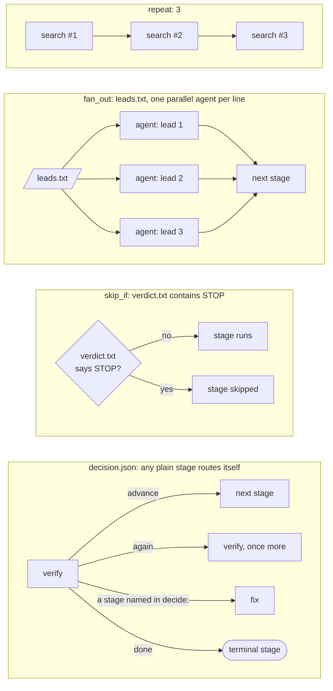
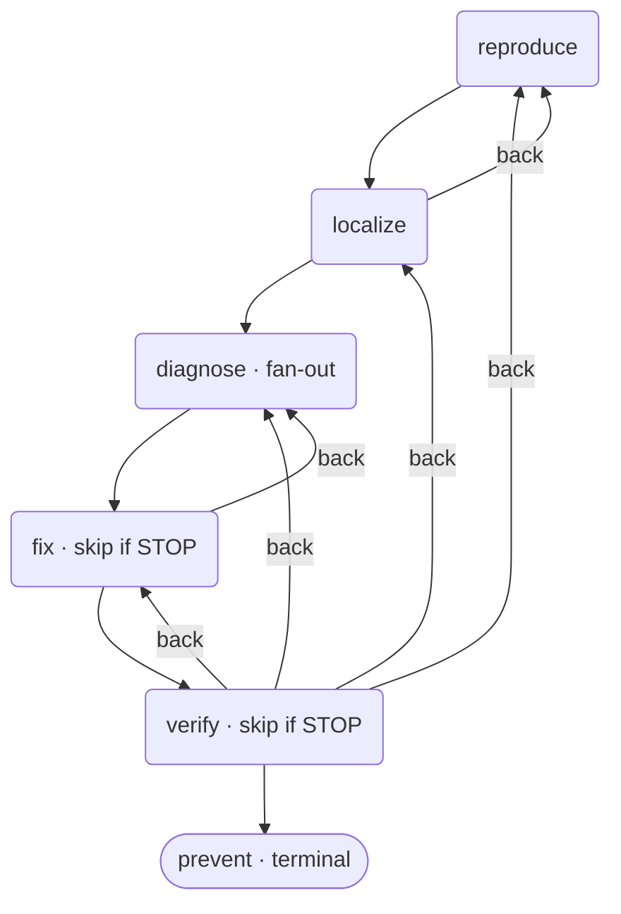
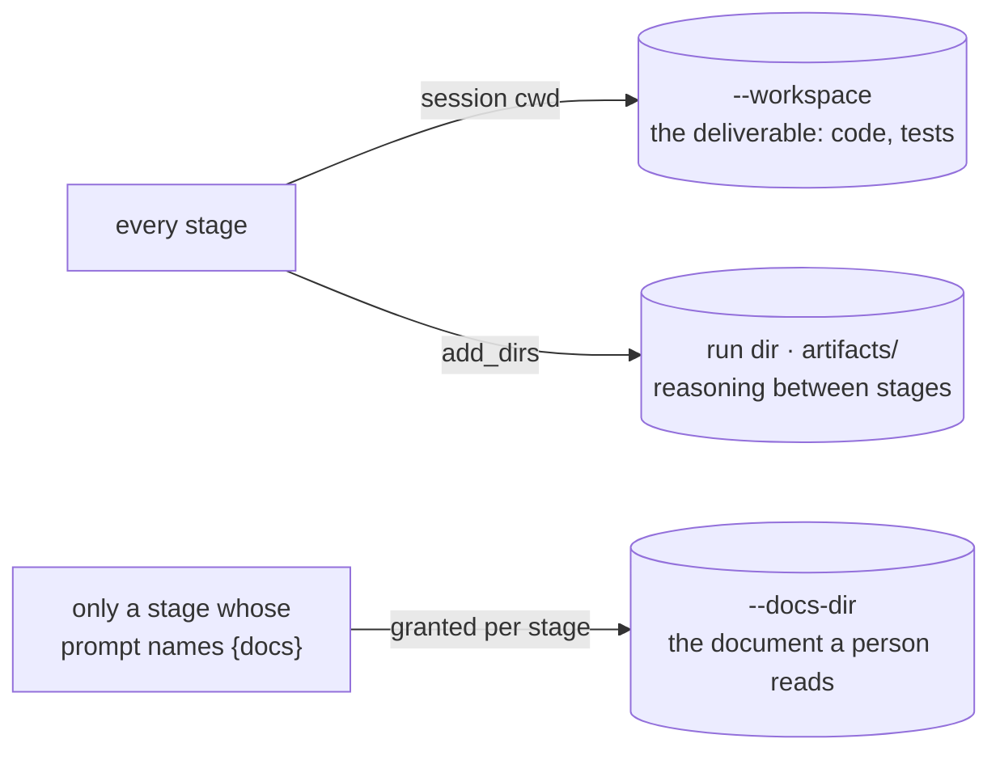

# Orchestra Engine

<p align="center">
  
</p>

<p align="center">
  <a href="https://github.com/Froredion/orchestra-engine/actions/workflows/ci.yml"></a>
  <a href="https://www.python.org"></a>
  
  <a href="LICENSE"></a>
</p>

<p align="center">
  <a href="#setup">Setup</a> · <a href="#how-to-use-it">Usage</a> · <a href="#pipelines">Pipelines</a> · <a href="UNDERSTANDING.md">How it works</a> · <a href="docs/authoring-pipelines.md">Write a pipeline</a>
</p>

**Hand Claude a multi-step job (fix this bug, build this feature) and get it
done the way a careful staff engineer would prompt it, step by step, without
sitting in the chat steering it.**

## Why use it

Give one agent session a big job and two things go wrong:

- **It gets worse the longer it runs.** Its context fills with dead ends, stale
  tool output and half-relevant search results, and all of that competes with
  the task for its attention.
- **It skips steps.** It fixes the bug before reproducing it, calls the work
  done without testing it, and you end up typing "now reproduce it", "now run
  the tests", "did you check X?" yourself.

Orchestra Engine fixes both by splitting the job into **stages**, each run by a
**fresh agent session** with one narrow job. You write the steps once, as a
folder of numbered prompt files, and the engine runs them in order:

```
bugfix/
├── 01-reproduce.md   # prove the bug exists, with a failing test
├── 02-localize.md    # find where it happens
├── 03-diagnose.md    # find why: one parallel agent per hypothesis
├── 04-fix.md         # fix the cause
├── 05-verify.md      # try to break the fix; send the run back if it fails
└── 06-prevent.md     # guard against it coming back
```

Each stage starts clean and gets only what the previous one chose to pass on:
its **summary**, its **session ID** (so the full transcript is there if the
summary is too thin) and the files it wrote. The noise dies with each session,
and no step gets skipped because the step *is* the agent's whole job. A stage
can also send the run back to an earlier stage, split into parallel agents
(one per hypothesis, one per lead), or repeat itself to cut its own output down.

Ten pipelines ship built in (bugfix, feature, refactor, code review, research
and more, see the [list](#pipelines)), and writing your own is just writing prompts.
It's built on the [Claude Agent SDK](https://code.claude.com/docs/en/agent-sdk).

> New here? [UNDERSTANDING.md](UNDERSTANDING.md) explains the whole system
> from zero context: the why behind the design, the execution model, and how
> workflows are organized.

## Setup

**You need:** Python 3.10+, and [Claude Code](https://code.claude.com) logged
in (run `claude` once and log in), or an `ANTHROPIC_API_KEY` in your
environment. No keys are stored in this repo.

**1. Get the code and install it.** The same on macOS, Linux, and Windows:

```bash
git clone https://github.com/Froredion/orchestra-engine.git
cd orchestra-engine
python bootstrap.py        # python3 on some systems
```

Or hand it to your agent: ask Claude Code to *"clone
github.com/Froredion/orchestra-engine and run its bootstrap.py"*. Put the clone
somewhere permanent (beside your other repos): your agent runs the engine from
that folder, whichever repo you're working in.

Bootstrap creates a `.venv` with whatever Python you ran it with and installs the
engine into it (editable). Re-running is safe, so run it again after a
`git pull` that changes dependencies. Don't `pip install` by hand: bootstrap
is the supported path, and `pyproject.toml` is the only dependency list.

**2. Teach your coding agent to drive it.** Bootstrap asks to do this for you
(answer `y`). To do it later, or again after a `git pull`:

```bash
./orchestra --install-guidance     # orchestra --install-guidance on Windows
```

Don't skip this one: the agent is how the engine is meant to be used (see
[How to use it](#how-to-use-it)). Step 1 gets the engine running; this gets an
*agent* running it correctly. The guidance is the part that isn't discoverable
from the code: launch a pipeline rather than reading its stage files, drive a
run over `--channel` with no terminal, watch for escalations, and leave every
permission prompt to the human, never answering one itself. It also records
where this checkout lives, so your agent can run the engine from any repo.
It lives in [orchestra_engine/agent_guidance.md](orchestra_engine/agent_guidance.md),
versioned alongside the code it describes.

It writes one `<orchestra-engine>…</orchestra-engine>` block to `~/.claude/CLAUDE.md`,
creating that file if you don't have one. Everything else in it (other
sections, your own notes) is left byte-for-byte alone, and re-running replaces
the block in place instead of stacking a second copy, so it's safe to run after
every `git pull`. `--print-guidance` shows the block without writing anything;
`--claude-md PATH` targets a different memory file (a repo's own `./CLAUDE.md`,
say, to scope the guidance to one project).

**3. Check it works.** Bootstrap ends by running this; run it yourself any time
something seems off:

```bash
./orchestra --doctor               # orchestra --doctor on Windows
```

It checks Python, the dependencies, your Claude login, the agent guidance, and
that every pipeline loads, and prints the command that fixes anything missing.
It runs no agents and costs nothing. `ok` and `warn` lines mean you're ready;
a `FAIL` line means a run would fail, so fix that first.

```
  ok    python            3.12.4
  ok    claude_agent_sdk  installed
  ok    questionary       installed
  ok    pywebview         installed
  ok    claude auth       logged in (claude.ai)
  ok    agent guidance    current in /Users/you/.claude/CLAUDE.md
  ok    pipelines         10 load

Ready to run a pipeline.
```

## How to use it

**Ask your coding agent to run it.** A main agent (Claude Code, set up with
step 2 above) drives the engine for you, and you watch:

> Run the orchestra bugfix pipeline on ~/code/shop: checkout fails when the
> cart is empty.

From there, three parties each do one job:

- **Your agent drives.** It launches the run (`./orchestra "…" --pipeline
  bugfix --workspace ~/code/shop -i --channel …`) without reading the stage
  files first, answers *run* at each stage gate, answers the stage agents'
  questions, watches for escalations, and hands you the result when the run
  ends.
- **The engine and its stage agents do the work**, one fresh session per stage,
  as described above.
- **You watch and decide.** Every run opens in the **live view**, an app
  window of its own (a browser tab on Linux), with each stage's thinking, messages
  and tool calls streaming in as a chat. Permission prompts are yours: your
  agent tells you when one is waiting and you click allow or deny there. When a run gives something up (an
  [escalation](#when-a-run-gives-something-up-the-escalation-record)), your
  agent tells you, and you decide what happens next.



Why an agent rather than you at the terminal: a run takes many minutes and
pauses at every stage gate, raises escalations that need judging in the moment,
and ends with output that needs reading. An agent can sit through all of that
and bring you only the parts that need a human. You can still run it yourself:
see [Running it yourself](#running-it-yourself).

## How a run works



Nothing else crosses a stage boundary: a stage gets the handoff (served by a
`read_handoff` tool when it asks for it) and whatever earlier stages wrote to
disk. Each stage can reach the previous stage's final summary and its session ID, so
it can pick up where the last agent left off, and read the previous session's
full transcript (`~/.claude/projects/<project>/<session-id>.jsonl`) if the
summary isn't enough.

## Pipelines

The engine doesn't care what the stages are. A **pipeline** is any folder of
numbered prompt files:

```
my-pipeline/
├── 01-research.md
├── 02-draft.md
├── 03-polish.md
└── handoff.md      # optional: override the default handoff template
```

Order comes from the filename sort; each prompt can use `{task}` and
`{handoff}` placeholders. Each built-in is described on its own page below;
`./orchestra --list` shows the live shape (stages, fan-out, routing) of each.

| Pipeline | What it does |
|---|---|
| [**approach**](docs/pipelines/approach.md) | decide *how* to solve a ticket, output a spec (analysis-only) |
| [**feature**](docs/pipelines/feature.md) | add a feature to existing code (brownfield, self-routing) |
| [**bugfix**](docs/pipelines/bugfix.md) | root-cause debugging: reproduce → … → prevent (self-routing) |
| [**research**](docs/pipelines/research.md) | noise-removing web research (fans out per lead) |
| [**investigation**](docs/pipelines/investigation.md) | answer a question by running the system (read-only) |
| [**triage**](docs/pipelines/triage.md) | localize a fault in data too large to read (read-only) |
| [**refactor**](docs/pipelines/refactor.md) | behavior-preserving structural cleanup on green tests |
| [**architecture**](docs/pipelines/architecture.md) | structural change across boundaries (analysis-first) |
| [**code-review**](docs/pipelines/code-review.md) | review a change, report verified findings (read-only) |
| [**research-paper**](docs/pipelines/research-paper.md) | research direction → systems/ML paper draft |

The numbered prompt files that make up each pipeline live under
`orchestra_engine/pipelines/` (see [Layout](#layout)).

**Pipelines compose**, and that's most of how they're meant to be used.

**A ticket, before it's a spec.** `feature` is faithful to whatever spec it's
handed. It pins the request's own words as tests before any design gets to
weigh them, which is right for a settled spec and wrong for a ticket nobody
has interrogated. `approach` is the run that comes first: it reads the ticket,
its comments and the thread, develops competing approaches in parallel, scores
each on robustness *and* on what it costs to get approved here, and hands
`feature` a spec worth being faithful to. So the loop is **a ticket arrives →
approach decides how → a human rules on the escalations → feature implements**
([details](docs/pipelines/approach.md#how-it-composes-with-feature)).

**Boundary work `refactor` won't touch.** You rarely reach for `architecture`
cold. Its natural trigger is `refactor`, which keeps flagging boundary problems
it won't touch into `PROPOSALS.md`; `architecture` turns those into a plan a
human approves and `feature`/`refactor` execute. So the loop is **refactor
finds → architecture plans → a human approves → feature/refactor do**
([details](docs/pipelines/architecture.md#how-it-composes-with-refactor)).



**Authoring your own?** [docs/authoring-pipelines.md](docs/authoring-pipelines.md)
is the frontmatter reference: `repeat`, `fan_out`, `skip_if`, `decide`,
`redirect` (point a stage at a prompt kept elsewhere, e.g. an existing
`SKILL.md`), the `handoff` scope, and the `decision.json` routing protocol every
plain stage uses to send the run forward or back. The shapes a stage can take,
at a glance:



Routing always halts: `--max-hops` caps total stage executions, and on reaching
it the run jumps to the terminal stage.

## Running it yourself

The usual way is to [ask your agent](#how-to-use-it); this is what it runs,
and you can run it by hand the same way. At a terminal, a short setup wizard asks for everything
(the task, which stages, interactive or autonomous). Use the launcher for your
OS from the repo root:

```bash
./orchestra   # macOS / Linux
orchestra     # Windows (cmd or PowerShell; .\orchestra also works)
```

```bash
# or, with the venv activated, the same on any OS:
#   macOS/Linux:  source .venv/bin/activate
#   Windows:      .venv\Scripts\activate
orchestra-engine
```

```
? Pipeline                       [arrow keys: built-ins, or "custom path…"]
? What should the orchestra work on?  add CSV export to the report command
? Which stages?
  ❯ all stages
    up to a stage… (drop everything after it)
    custom selection… (checkbox list)
? Mode
  ❯ interactive — agents can ask you questions; you gate each stage
    autonomous  — runs unattended, no questions

  task:     add CSV export to the report command
  pipeline: feature
  stages:   explore -> ... -> integrate
  mode:     interactive
? Start the run?
  ❯ start
    cancel
```

**Esc goes back one question** from anywhere in the wizard (left arrow works
on menus too; in plain-prompt fallback mode type `<`). The same works between
questions when an agent asks you several at once. Ctrl+C cancels outright.

The same pickers are used everywhere: when an agent asks you a question
mid-stage (its options + a "type my own answer" choice), at every stage gate
(run / skip / quit), and for tool approvals. In pipes and scripts everything
degrades to plain numbered prompts automatically.

Any option you pass as a flag is skipped by the wizard. For scripting, `-y`
skips the wizard entirely (and piped/non-terminal runs never see it):

```bash
# scripted, fully autonomous
./orchestra "build a todo CLI app" -y

# your own pipeline
./orchestra "write a blog post about X" --pipeline ./my-pipeline -y
```

Options:

To see what's available without running anything, `--list` describes every
built-in pipeline and the shape of each stage:

```bash
$ ./orchestra --list

bugfix
  reproduce
  localize [decides: may loop back to reproduce]
  diagnose [parallel per hypotheses.txt, top 3]
  fix [skipped if verdict.txt contains 'STOP'] [decides: may loop back to diagnose]
  verify [skipped if verdict.txt contains 'STOP'] [decides: may loop back to reproduce, localize, diagnose, fix]
  prevent
...
```

`./orchestra --list --pipeline ./my-pipeline` describes your own folder the same
way. It's a quick check that the frontmatter parsed the way you meant, since a
malformed block is otherwise silent. `./orchestra --help` explains the execution
model itself, so an agent landing in this repo with no context can get
oriented from the CLI alone.

### Overlays: add pipelines without copying the engine

You don't have to pass a full path to run your own pipeline. Point the engine
at one or more directories of pipeline folders and it discovers them **by
name**, right alongside the built-ins: in `--list`, in the wizard, and as
`--pipeline <name>`:

```bash
# a repeatable flag…
./orchestra "ship it" --pipeline delivery --pipelines-dir ~/my-pipelines

# …or the environment, so a wrapper can set it once
export ORCHESTRA_PIPELINES_PATH=~/my-pipelines   # os.pathsep-separated for several
./orchestra --list           # 'delivery' now shows up next to bugfix, feature, research
```

Each directory is a *parent* holding pipeline subfolders (the same shape as
`orchestra_engine/pipelines/`). Overlays are searched before the built-ins, so an
overlay may deliberately shadow a built-in of the same name; the built-in dir
is always searched too, so overlays only ever add. `--list` prints each
pipeline's resolved directory, so you can always see which one won.

**Grouping.** A subfolder that holds *pipelines* rather than stage files is a
**group**, which is organizational only. The engine looks one level inside it, so
`structural/refactor` and `structural/architecture` are discovered exactly as
`refactor` and `architecture`: names stay flat and globally unique, you still
run `--pipeline architecture` (never a path), and `--list` tags the pipeline
`[group: structural]` so the family is visible. It's one level deep by design
(groups don't nest), which keeps names unambiguous and a symlinked cycle from
looping discovery. Use it to keep siblings together (the built-in `structural/`
and `diagnosis/` pairs are the examples); a folder with neither stage files nor
pipelines inside is simply ignored, never a phantom entry.

### Connect a new repo: make one that is only `pipelines/`

This is what lets a separate repo be *only* its extra pipelines and reuse this
engine instead of forking it. There is nothing to wire up by hand:
[`overlay-template/`](overlay-template/) **is** a working overlay repo, so copying
that one folder is the entire setup.

```bash
# 1. Copy the template next to your engine checkout. That's the install.
cp -R ~/code/orchestra-engine/overlay-template ~/code/my-pipelines
cd ~/code/my-pipelines

# 2. It already runs: the template ships a two-stage `example` pipeline
./orchestra.sh --list
./orchestra.sh "add retries to the client" --pipeline example --workspace ~/code/some-repo

# 3. Make it yours: rename the example, edit the prompts, drop the README title
mv pipelines/example pipelines/my-pipeline
git init && git add -A && git commit -m "Pipelines for the Orchestra Engine"
```

Anyone who clones that repo beside an engine checkout can run it with no install
step, because the engine and its venv are the only things that need installing
and they already exist.

**What's in the folder**, and why each piece earns its place:

```
overlay-template/
├── orchestra.sh              # the launcher: finds the engine, hands over. Never edit it.
├── .gitattributes       # pins orchestra.sh to LF, so a Windows checkout can still run it
├── .gitignore           # keeps run output (orchestra-docs/, workspace/) out of the repo
├── README.md            # a starter README for the new repo; retitle and keep
└── pipelines/
    └── example/         # a real two-stage pipeline: copy it, then delete it
        ├── 01-plan.md
        └── 02-build.md
```

**The structure it expects** is just the launcher at the root and a `pipelines/`
directory holding pipeline folders:

```
my-pipelines/
├── orchestra.sh
└── pipelines/
    ├── my-pipeline/
    │   ├── 01-plan.md         # NN-name.md: numbered, sorted, that's the order
    │   └── 02-build.md
    └── family/                # optional: a folder of pipelines is a *group*,
        └── nested/            #   organizational only, exactly one level deep
            └── 01-go.md       #   still run as --pipeline nested
```

A folder is a pipeline when it holds a numbered `NN-name.md` (or `NN_name.md`);
a folder holding none of those is read as a group and its children are scanned
instead. Get this wrong and `orchestra.sh` says so up front, naming the layout it
wanted, rather than running with an overlay that silently contributes nothing.

**What it does.** It resolves its own directory from `$0` (so it works from any
cwd), puts that repo's `pipelines/` at the front of `$ORCHESTRA_PIPELINES_PATH`, and
`exec`s the engine's own `./orchestra`. Every flag passes straight through, and the
built-ins are still appended after your overlay, so `--pipeline bugfix` keeps
working next to your own names.

**How it finds the engine**, first hit wins:

1. `$ORCHESTRA_ENGINE_DIR` (or the older `$LOOP_ENGINE_DIR` / `$LOOP_ENGINEERING_DIR`):
   an explicit choice always wins, and a wrong one is reported rather than masked by a fallback.
2. A sibling directory: `orchestra-engine` (or the older `loop-engine` /
   `loop-engineering`) by name, then the
   directory containing the overlay, then any other sibling that validates, so a
   clone under a third name works, and so `overlay-template/` still runs while it
   sits inside this repo.
3. The `orchestra-engine` console script on `$PATH`, for a pip-installed
   engine with no checkout beside you at all.

A candidate counts as the engine only if it has **both** an executable `orchestra` and
`orchestra_engine/pipeline.py`. That second check is the subtle part: a sibling
checkout of another *overlay* also has a `./orchestra`, so testing for that alone
resolves the "engine" to an overlay and then fails deep inside the stage handoff,
far from the cause. Neither repo's directory name is ever assumed.

**Why an overlay and not a fork.** A fork is a whole copy of the engine, so
keeping a few private pipelines on top means syncing the entire engine forever,
and the two drift. As an overlay the repo carries only what's actually different,
and picks up every engine change the moment you pull the engine. There is nothing
to sync.

To *see* the routing rather than read it, `./orchestra --graph --pipeline bugfix`
prints a Mermaid flowchart (the forward spine plus every declared loop-back
edge) wrapped in a ` ```mermaid ` fence so it renders in a GitHub Markdown
file or at mermaid.live. This is its output, verbatim:



| Flag | Default | Meaning |
|---|---|---|
| `--list` | off | Describe the available pipelines (built-in + overlays) and their stages, then exit. With `--pipeline`, describe just that one (a path works too). Runs nothing. |
| `--graph` | off | Print a Mermaid routing graph of the pipeline(s) and exit (read-only). With `--pipeline`, just that one. |
| `--install-guidance` | off | Install this engine's agent guidance into your global Claude Code memory as one `<orchestra-engine>` block, then exit. Idempotent: replaces the block in place, leaves the rest of the file alone. Runs nothing. |
| `--print-guidance` | off | Print that guidance block to stdout and exit, writing nothing. |
| `--claude-md` | `~/.claude/CLAUDE.md` | Which memory file `--install-guidance` writes to. |
| `-y`, `--defaults` | off | Skip the setup wizard; use flags/defaults as-is |
| `--pipeline` | the wizard asks | Pipeline name (built-in or overlay) or path to a pipeline directory. There is no default: a scripted run (`-y`, or no terminal) without it exits saying so rather than walking a pipeline nobody named |
| `--pipelines-dir` | none | Extra directory of pipeline folders to discover by name (repeatable; or set `$ORCHESTRA_PIPELINES_PATH`) |
| `-i`, `--interactive` | off | Human-in-the-loop: agents ask you questions via the built-in AskUserQuestion tool, tool calls the permission mode doesn't auto-approve need your y/n, and each stage starts with a run/skip/quit gate. Prompts appear in the live view; with `--no-ui` they're asked in the terminal instead. To drive it from another process, use `--channel`. |
| `--no-stage-gates` | off | With `-i`, skip the run/skip/quit prompt before each stage and just walk the pipeline. Agents can still ask you questions and non-auto-approved tool calls still need your y/n; only the per-stage gate goes. For pipelines where you're present to *do* the work rather than supervise the walk, the gate is ceremony between you and it |
| `--channel DIR` | off | Drive the run from another process instead of stdin. The engine appends one JSON event per line to `DIR/events.jsonl`: stage start/finish, each escalation as it's raised, run complete, and every prompt with an id and a kind (`gate` / `question` / `permission`). Every prompt then waits for `--answer`. Give each run a fresh DIR, outside the workspace and the runs/docs dirs (refused otherwise: whoever writes it answers the permission prompts). Created `0700` |
| `--answer ID VALUE` | none | With `--channel DIR`: answer the waiting prompt with an option's number or value, `1,3` for a checkbox, or free text. Refused unless ID is the prompt actually waiting, or if the option is out of range, so a stale reply can't land on the wrong question |
| `--watch` | none | With `--channel DIR`: print each event as one line and exit when the run completes or its engine dies. Can start before the run. Built to be streamed by a monitoring tool |
| `--no-ui` | off | Terminal only. By default every run appears in the **live view**, one window for all runs (an app window on macOS/Windows, a browser tab on Linux): each run in the sidebar (running / needs you / finished / stopped), its stages under it, and its thinking, messages and tool calls streaming in as a chat, with every prompt answered by a button. One shared viewer serves it on `127.0.0.1` behind a one-off token; the first run starts it, later runs join it without opening another, and it exits once idle. Runs are recorded in `~/.orchestra-engine` (`ORCHESTRA_ENGINE_HOME` overrides). This flag turns all of that off (CI, SSH); prompts then go to stdin unless `--channel` is given |
| `--view [DIR]` | none | Open the live view without starting a run; finished runs stay browsable there. With DIR, a channel directory recorded elsewhere is added to it first |
| `--stages` | all | Comma-separated subset of the pipeline's stages (order preserved) |
| `--repeat` | frontmatter | Per-stage repeat overrides, e.g. `--repeat search=5,deep-dive=3` |
| `--max-items` | frontmatter | Per-stage fan-out caps, e.g. `--max-items deep-dive=10` |
| `--workspace` | `./workspace` | Directory the agents work in |
| `--permission-mode` | `auto` | Agent permission mode. `bypassPermissions` auto-approves every tool call, so it warns and asks you to confirm before starting, and refuses rather than proceed if there's no input to ask on |
| `--dangerously-skip-permissions` | off | Confirms `bypassPermissions` up front instead of prompting, so unattended runs don't stall. Implies it: agents get unreviewed file and shell access to `--workspace`. Only point it at a workspace you can afford to lose |
| `--setting-sources` | `project` | Which settings layers each stage agent loads: a comma-separated subset of `user,project,local`, or `none`. `user` is off by default on purpose: your `~/.claude/CLAUDE.md` is written for your own sessions, and inside a stage it lands as a second, unasked-for instruction (see [Why stages don't read your global CLAUDE.md](#why-stages-dont-read-your-global-claudemd)). Add it back only when a pipeline needs something living there, such as a user-level MCP server |
| `--max-turns` | none | Turn cap per stage. A stage that hits it fails without retrying. The cap is the problem, and three more attempts walk into the same wall at full price |
| `--max-hops` | 2× stage count | Cap on total stage executions once stages start routing back on themselves; on reaching it the run jumps to the final stage and ends. A clean forward run spends ~1× and never nears it (see [Deciding what's next](docs/authoring-pipelines.md#deciding-whats-next-every-plain-stage-routes-itself)) |
| `--model` | Claude Code default | Model override for all stages |
| `--runs-dir` | `./orchestra-docs/runs` | Where each run's directory goes: the stage documents and the JSON log |
| `--run-dir` | a fresh one | Continue inside an existing run directory instead of minting one, so a run that ended on a question can be answered without re-deriving the map, the baseline and the design it already produced. Pair with `--stages` to re-run only what the answer changes. The pass writes its own `run-2.json` beside the first log and snapshots the documents it inherits into `artifacts/prior/resumed-N/`, so nothing the earlier pass established is overwritten unrecorded. Must live under `--runs-dir`: stage agents are granted the run's artifacts directory, so the path has to be one the command names. Refuses to start if the earlier pass's `skip_if` gate would skip the first stage, since a stale `STOP` verdict otherwise makes the resumed run do nothing and say so as if it were an answer. **Also how an interrupted fan-out picks up:** each fan-out item is recorded in `checkpoints/fanout-<stage>.json` the moment it finishes; if an item's session raises (a usage limit, most often), items already running finish, queued ones aren't started, and the engine exits printing the exact `--run-dir … --stages …` to add. Re-entering the stage runs only the unfinished items; the record is removed when the stage completes, so a later route-back redoes everything it was sent back for |
| `--docs-dir` | `./orchestra-docs/plans` | Where a pipeline publishes the document a *human* reads. A run directory is named for a timestamp, holds a dozen intermediate files, and is often a scratch path that gets deleted. That's fine for one agent handing to the next, wrong for the deliverable of a pipeline whose whole output is a document. Stages reach it as `{docs}` and publish into a folder named for the subject (`orchestra-docs/plans/abc-123/`), so it is still findable next month. Only the stages whose prompt names `{docs}` are granted write access to it, so the ten stages before the publishing one can't touch your folder. Pipelines that publish nothing ignore it and nothing is created |

## Why stages don't read your global CLAUDE.md

A stage's instruction is its prompt. That's the premise the whole engine rests
on: a fixed decomposition, each stage a fresh session that knows exactly what
it was handed and nothing else.

The Claude Code CLI, left to its own default, loads your `~/.claude/CLAUDE.md`
into every session it starts, including every stage the engine runs. Personal
global memory is written for your own interactive work, and inside a stage it
stops being context and becomes a co-instruction competing with the prompt. A
standing rule like "always call this MCP tool before writing code" turned a
measured two-turn stage into seven, at 5× the cost, for the same file.

The sharpest version of the problem is self-inflicted: `--install-guidance`
writes this engine's *driver* guidance into that same file: launch pipelines
rather than read them, never answer a permission gate yourself, surface it to
the human. A stage agent inheriting that reads instructions written for the
agent *driving* the engine, and defers instead of working. The run stops being
able to proceed on its own.

So the engine sets the layer list explicitly rather than inheriting a default:
`project` only. That one resolves against the workspace, so a target repo still
describes its own conventions to an agent working on it: context about the
deliverable, not instructions from somewhere else. `--setting-sources` overrides
it when a pipeline genuinely needs a user-level layer.

## Watching a run: the live view

A run isn't a black box you wait on. The first run opens the **live view** in
an **Orchestra Engine** window of its own: a native app with its own Dock /
taskbar entry on macOS and Windows, so it doesn't get lost among (or closed
with) your browser tabs. On Linux, or wherever that window can't start, the
same page opens in your browser instead. Later runs join the open window
rather than opening another, it outlives the run that opened it, and
`./orchestra --view` brings it back after you close it, and finished runs stay
browsable there.

One window holds every run: the sidebar lists each one as running / needs you /
finished / stopped, with its stages under it, and the selected run streams in
as a chat. Three things stream:

- **💭 thinking**: the model's own reasoning, summarized as it goes. This is
  the part worth watching: it's how you learn *why* a stage did what it did,
  not just that it did it. Opus 4.7+ hides thinking text by default (blocks
  arrive signature-only), so the engine turns it back on
  (`thinking: adaptive/summarized`) precisely so a watching human isn't left
  staring at tool calls with no narration. It stays display-only: reasoning
  never leaks into the summary handed to the next stage.
- **tool calls**: every one, with the argument that says what it's *doing*:
  the file path, the shell command, the search pattern, the URL. `Read
  src/client.py` tells you the step; a bare `Read` ten times over wouldn't.
- **messages**: the stage's actual output as it's written.

Escalations show up as callouts, and every prompt (stage gate, agent
question, permission allow/deny) as buttons you can answer right there.

### The same stream in the terminal

The run also prints all of it to stdout, each line tagged with the stage that
produced it, so `run.log` holds the full record whether or not anyone had the
window open:

```
[reproduce] session started: 4f3c1a20-…
[reproduce] 💭 The report says timeout=0 waits forever. Before writing a test
            I want to see where the client actually reads that value…
[reproduce] -> tool: Grep  (timeout)
[reproduce] -> tool: Read  (src/client.py)
[reproduce] Two candidate reproductions written; the second fails for the
            right reason: it hangs on timeout=0 and passes once bounded.
[reproduce] -> tool: Write  (tests/test_timeout_zero.py)
```

Tool calls are collapsed to one line and capped at 100 chars so the stream stays
readable. When the run finishes, a compact ledger of every stage execution:
status, session ID, turn count, cost:

```
===== RUN COMPLETE =====
  reproduce                [ok]  session=4f3c1a20-…  turns=12  cost=$0.0834
  localize #1              [ok]  session=8b2e…       turns=8   cost=$0.0511
  diagnose (hypothesis 2)  [ok]  session=…           turns=15  cost=$0.1002
  ...
```

With `--no-ui` (CI, SSH, no display) the terminal is the only view; redirect
to a log and `tail -f` it to follow along:

```bash
./orchestra "…" --pipeline bugfix --workspace ./repo -y --no-ui > run.log 2>&1 &
tail -f run.log
```

### Driving a run from another process

This is the mechanism behind [How to use it](#how-to-use-it). With
`--channel DIR`, the same run can be driven by a script or another agent while
a human watches in the live view. Both sides read one event stream and
answer prompts by id, so a stale answer is refused instead of landing on the
wrong question. Stage gates are the driver's to answer; permission prompts are
the human's (the diagram under [How to use it](#how-to-use-it) shows the
exchange).

## When a run gives something up: the escalation record

A long autonomous run can end by delivering less than it was asked for, and the
honest version of that failure looks exactly like success: the suite is green,
the write-up is coherent, and the criterion that got quietly narrowed goes
unmentioned because every document was rewritten to agree. `ESCALATIONS.md` is
the file that stops it. A stage appends there when the run stops promising
something: a behaviour withdrawn, an acceptance criterion narrowed, a stated
requirement that fights a convention and got built anyway.

Every stage of every pipeline is told about it, in the same preamble that names
the two writable directories, so the channel doesn't depend on a pipeline
author remembering to ask for it. A pipeline's own prompts can be more specific
about what counts (the `feature` stages are), but the floor is always there.

It is **append-only, and the engine enforces that.** A stage may append a
rebuttal beneath an earlier entry; a stage that rewrites the file gets the
earlier text put back above its version. Route-backs are the reason: the stage
that raised a concern is rarely the last one to write, so otherwise a later pass
settles the matter by deleting the sentence that recorded it, and the run ends
looking like nothing was ever given up.

The engine reports it twice: the new text at the stage boundary that produced
it, and the whole record again when the run ends:

```
[design] stage finished in 21s
ESCALATIONS.md grew — this stage raised:
  | AC-1: the request asks for a unix epoch integer; this module's stated
  |       contract is ISO-8601 strings. Built as asked, flagged for a human.
…
===== ESCALATIONS.md: raised during this run, unresolved =====
  | AC-1: …
Full record: …/artifacts/ESCALATIONS.md
```

Every line is quoted with `  | `. The text is agent-written and what reads this
log is often another agent deciding what to do about it, so no stage gets to
emit a line that arrives looking like engine output.

**Nothing halts on an escalation.** Whether to stop is a judgement about the
entry, not a policy: a conflict that got built as asked is usually
informational and the run should finish (a completed run is better input to
"should we change the spec" than a half-finished one), while a withdrawal is
worth stopping for rather than letting later stages build on it. So the decision
belongs to whoever is watching, with the entry in front of them. An agent driving
a background run can watch the file and be notified the moment an entry lands;
`./orchestra --print-guidance` includes the recipe.

## Resilience

A run can span many minutes and real token cost across a chain of stages; a
single dropped connection in stage 4 of 6 must not throw away the four stages
that already succeeded. So a stage that hits a transport fault is retried, up
to 3 attempts with a short backoff, each attempt a fresh session that sees
whatever files the failed one already wrote. The retry shows up in the stream,
it doesn't happen behind your back:

```
[diagnose] session error on attempt 1/3 (…) — retrying in 2s
```

Two classes of error are deliberately *not* retried, because retrying would
only reproduce them: authentication failures (same credentials, same result),
and a tool result that overflowed the SDK's 1 MB message buffer (the agent
would just read the same oversized thing again). For the latter, the engine
raises the buffer ceiling to 16 MB up front instead: agents routinely crawl
PDFs and clone repos, so a large tool result is ordinary, not pathological.

## Where things get written

**Code goes in the repo, reasoning goes in the run, and the document you read
goes somewhere you can find it.** The outputs of a run are kept apart on
purpose, and each root is granted to a stage a different way:



```
orchestra-docs/runs/20260716-054829/   <- one directory per run
├── run.json                       # pipeline name, per-stage summaries,
│                                  # session IDs, turn counts, costs,
│                                  # and the run's total wall-clock time
└── artifacts/                     # the stage documents
    ├── REPRO.md                   #   what reproduce told localize
    ├── verdict.txt                #   what gates the fix stage
    ├── hypotheses.txt             #   what diagnose fans out over
    ├── ESCALATIONS.md             #   what the run stopped promising, if
    │                              #   anything (append-only, engine-enforced)
    └── POSTMORTEM.md              #   what you read afterwards

your-project/                      <- --workspace: only the deliverable
├── src/parser.py                  #   the fix
└── tests/test_parse_empty.py      #   the test that guards it

orchestra-docs/plans/                  <- --docs-dir: written for a person
└── abc-123/                       #   one folder per subject, not per run
    ├── SPEC.md                    #   what was decided
    ├── DECISION.md                #   what else was considered, and why not
    └── README.md                  #   the handback: what to do next
```

Those documents are not decoration. They are the *only* wide channel between
stages. Each stage is its own SDK session, so all that crosses a boundary is a
one-paragraph handoff and whatever is on disk; a summary can't carry a verbatim
stack trace, and `fan_out` needs a real file to read. But they're the run's
reasoning, not your project's, so they don't belong in your repo:

- **Your repo stays clean.** `git status` after a run shows the change you
  asked for, not eight markdown files interleaved with it.
- **Runs stop clobbering each other.** The directory is named for the start
  time, so a second run against the same repo can't overwrite the first run's
  evidence.
- **The record is complete.** `run.json` and the artifacts that produced it sit
  in one folder you can archive or delete as a unit.

The third root exists because not every pipeline's deliverable is code.
`approach` decides *how* a ticket should be solved and builds nothing, so what
leaves the run is a document somebody has to read, argue with, and approve,
and a timestamped folder of fifteen intermediate files is where that goes to
die. So the reader's copy is published separately, named for the ticket rather
than the clock. The run directory still keeps the full copy: the record stays
complete whether or not anyone touches the published one.

Agents get these writable roots and no others (the workspace via the session's
`cwd`, the artifacts directory via the SDK's `add_dirs`) and are told in every
prompt which one takes what. The documents directory is a third, handed out one
stage at a time: a stage is granted it only if its own prompt names `{docs}`,
so a pipeline's publishing stage can write there while every stage before it
still cannot. `fan_out` and `skip_if` paths resolve against the artifacts
directory, and are confined to it: a path that escapes it, whether by `..` at
load time or a symlink at read time, is refused.

## Layout

The engine lives in `orchestra_engine/`; every built-in pipeline is a folder of
numbered prompt files under `orchestra_engine/pipelines/`. `./orchestra` and `orchestra.cmd`
launch this repo; [`overlay-template/`](overlay-template/) is not part of this
repo's own operation at all; it's the folder you copy to start a pipelines-only
repo ([recipe](#connect-a-new-repo-make-one-that-is-only-pipelines)). The engine
was formerly **Loop Engine**; the old `LOOP_*` engine-location variables are still
honored by the overlay launcher. Two sources
stay authoritative, so this file can't drift out of sync with the code:

- **The engine's source map** (what each module does) is the module table in
  [UNDERSTANDING.md](UNDERSTANDING.md#single-responsibility-across-modules).
- **Each pipeline's live shape** (its stages, fan-out, gates, and routing)
  comes from `./orchestra --list` (or `./orchestra --graph`); the prose lives under
  [docs/pipelines/](docs/pipelines/), the frontmatter reference in
  [docs/authoring-pipelines.md](docs/authoring-pipelines.md).

## Tests

No API calls: the session runner is stubbed. `bootstrap.py` installs pytest
along with the engine:

```bash
.venv/bin/pytest
```
